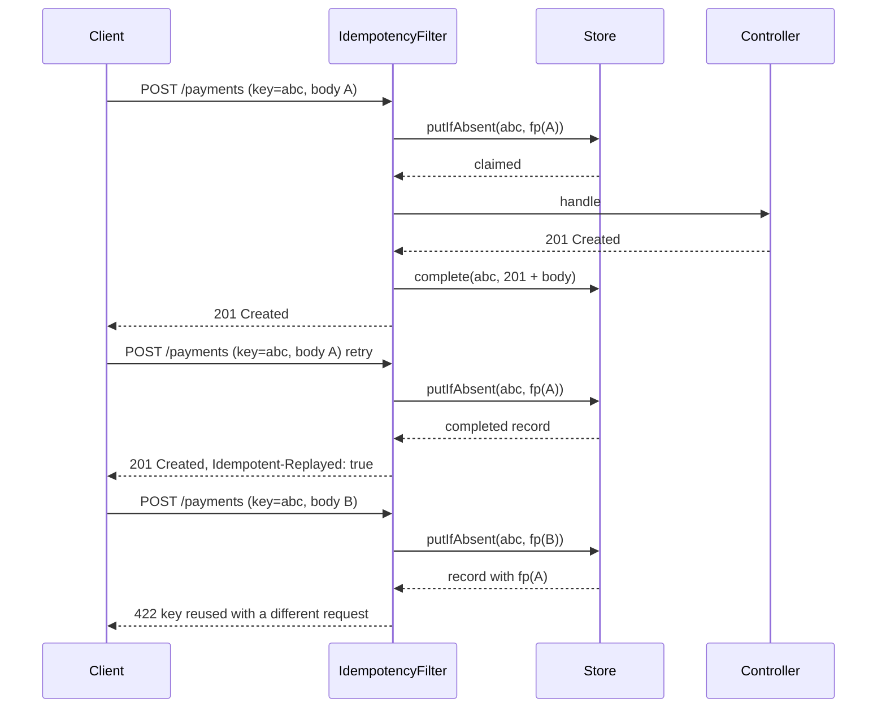

# idempotency-spring-starter

[](https://github.com/HelenArams/idempotency-spring-starter/actions/workflows/ci.yml)
[](LICENSE)

A small Spring Boot starter that adds `Idempotency-Key` support to Spring MVC endpoints. You put
`@Idempotent` on a controller method, and retries with the same key get the original response back
instead of running the handler a second time.

## Why I wrote this

I work on card payments, and the same bug keeps showing up in different clothes: a client times
out, retries, and the customer gets charged twice. A mobile app on a flaky connection, a checkout
button someone clicks twice, a gateway that retries on 504 - all of them end up sending the same
`POST /payments` more than once. The server has no way to tell "new payment" from "same payment,
again" unless the client gives it a key.

The idea isn't new (Stripe has done it for years, and there's an IETF draft for the
`Idempotency-Key` header), but every time I needed it in a Spring service I ended up writing the
same filter again. So this is that filter, cleaned up once, with tests.

It works for what I needed. It's not battle-tested at scale, so read the code before you put it in
front of real money.

## How it behaves

| Request                                         | Response                                                  |
|-------------------------------------------------|-----------------------------------------------------------|
| no key on an `@Idempotent` endpoint             | `400` problem+json (unless `optional = true`)             |
| new key                                         | handler runs, 2xx response is stored                      |
| same key + same request, first one finished     | stored status/headers/body, plus `Idempotent-Replayed: true` |
| same key + same request, first one still running| `409 Conflict` - retry a bit later                        |
| same key + different method/path/body           | `422 Unprocessable Entity`                                |
| handler threw, or returned non-2xx              | nothing stored, key is released so the client can retry   |

"Same request" means the SHA-256 of method + path + query string + raw body matches. Headers are
not part of it on purpose, since trace ids and auth tokens change between retries.



## Using it

It's not on Maven Central, so `mvn install` it locally first, then:

```xml
<dependency>
  <groupId>com.helenaramyan.idempotency</groupId>
  <artifactId>idempotency-spring-boot-starter</artifactId>
  <version>0.1.0-SNAPSHOT</version>
</dependency>
```

```java
@PostMapping("/payments")
@Idempotent(ttl = "24h")
public ResponseEntity<Payment> create(@Valid @RequestBody CreatePayment request) {
    ...
}
```

You can also put `@Idempotent` on the controller class. `@Idempotent(optional = true)` lets
requests without a key through unprotected, which helped me while older clients were still
being updated.

```bash
curl -i -X POST localhost:8080/payments \
  -H 'Content-Type: application/json' \
  -H 'Idempotency-Key: 7c1f0f6e-order-1001' \
  -d '{"amount": 2599, "currency": "EUR", "cardToken": "tok_visa_4242"}'
```

Run it twice and the second response has `Idempotent-Replayed: true` and the same payment id.

### Properties

| Property                      | Default            | What it does                                              |
|-------------------------------|--------------------|-----------------------------------------------------------|
| `idempotency.enabled`         | `true`             | turn the whole thing off                                  |
| `idempotency.header-name`     | `Idempotency-Key`  | header to read the key from                               |
| `idempotency.ttl`             | `24h`              | how long responses are kept (per-endpoint `ttl` wins)     |
| `idempotency.store`           | `memory`           | `memory` or `redis`                                       |
| `idempotency.key-prefix`      | `idempotency:`     | prepended to keys, useful on a shared Redis               |
| `idempotency.store-failures`  | `false`            | also store and replay non-2xx responses                   |

### Stores

- **memory** - `ConcurrentHashMap` with lazy expiry. Fine for tests and single-instance apps, useless
  as soon as you have two pods.
- **redis** - add `spring-boot-starter-data-redis`, set `idempotency.store=redis`. A key is claimed
  with a single `SET key value NX PX ttl`, so the marker and its TTL go in atomically. Completing uses
  a tiny Lua script that only overwrites if the fingerprint still matches - if your request was so
  slow that its marker expired and someone else claimed the key, you don't clobber them.

Or define your own `IdempotencyStore` bean and the auto-config backs off.

## Things to know

- The request body is buffered in memory to fingerprint it. Fine for payment JSON, not for uploads.
- Async controllers (`DeferredResult`, `Callable`) aren't supported, the key is just released.
- The in-flight marker lives as long as the TTL. If a node dies mid-request, that key returns 409
  until it expires. For payments I'd rather fail closed here than risk a double charge.

## Repo layout

```
idempotency-core/                store contract, fingerprint, in-memory + redis stores
idempotency-spring-boot-starter/ @Idempotent, the filter, auto-configuration
example-payments-api/            tiny POST /payments app to poke at
```

## Building

```bash
make build      # mvn verify -DskipITs, unit + MockMvc tests
make itest      # Redis tests via Testcontainers, needs Docker
make run        # starts the example on :8080
```

Java 17, Spring Boot 3.1.

## Maybe later

- [ ] separate (shorter) TTL for the in-flight marker, so a crashed node doesn't block a key for 24h
- [ ] micrometer counters for replays / conflicts
- [ ] a JDBC store, for people who don't run Redis

## License

Apache 2.0, see [LICENSE](LICENSE).
